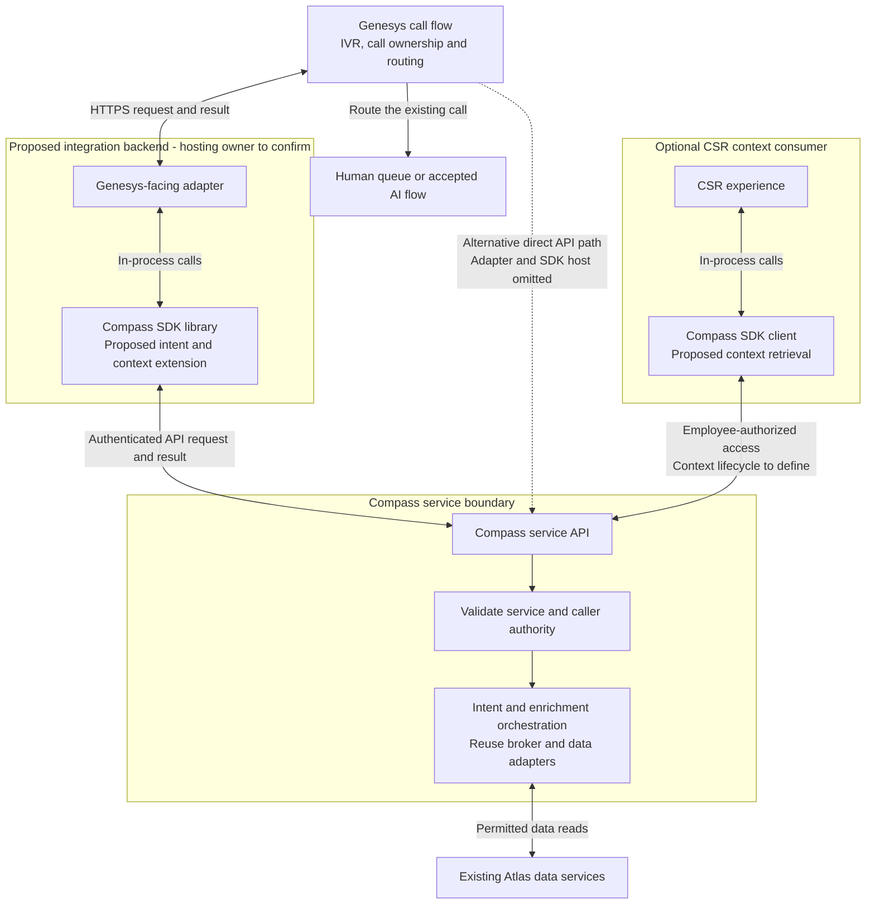
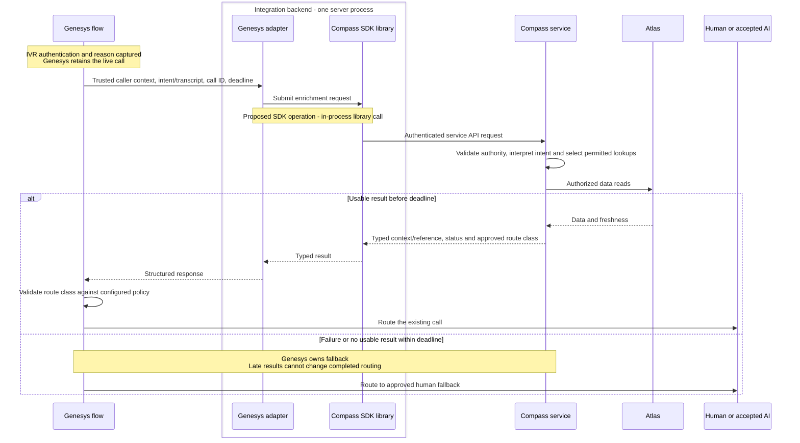
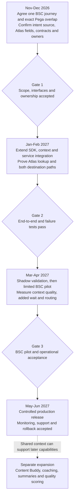

# Compass + ShieldAdvisor

| Benefits + KB in SA via SDK | Call Summarization + Live Transcribe | Live Agent Queries | Other Agent Capabilities |
| --- | --- | --- | --- |
| Q1 | Q2 | Q3 |  |
| Integrate Compass CSR Chat into Shield Advisor brining Benefits Inquiry into the Agent Desktop. Along with this integration will bring Agent inquiry from KB article summarization and quick reference. |  |  |  |

Review draft. Target: a bounded BSC production service in Q2 2027, subject to the scope and exit gates below. Last reviewed November 5, 2026.

Compass would use authenticated caller context and intent to retrieve permitted Atlas data before Genesys routes the existing call to a human or an accepted AI destination. The SDK is the reusable client and contract for accessing that service. Genesys retains ownership of the live call.

# Outcome and initial scope

Alison's [request](https://teams.microsoft.com/l/message/19%3a8333778d-ff63-4217-bb72-294188a36c86_af366c5a-6d5a-431b-89d1-e1718271b744%40unq.gbl.spaces/1793808940461?context=%7B%22contextType%22:%22chat%22%7D) describes Contact Center Modernization as a multiyear initiative, PTP as a major stakeholder through the Genesys reseller arrangement, and a Pega AI request for Shield Central in AI governance. Compass coverage of the underlying need remains a product hypothesis until the exact service requirements are mapped.

Start with one agreed BSC inbound journey, a defined population and intent set, and a small set of required Atlas fields. The service must return a structured outcome that Genesys can consume, deliver permitted context to the receiving human or AI service, and preserve normal routing when assistance is unavailable.

The initial scope includes:

- A defined post-authentication intent checkpoint and an agreed intent producer.
- A Compass service contract for verified caller context, intent or transcript, correlation identifiers, deadlines and results.
- Intent-conditioned Atlas reads through approved services and existing adapters.
- A typed result containing completion status, permitted context or a context reference, freshness, and an approved routing class.
- Genesys consumption of that result, routing policy enforcement, human fallback and traceability.
- SDK support where it improves integration reuse, plus explicit validation of the selected hosting and authentication model.

The exact planned or in-development Pega function being superseded remains to be agreed. This scope does not establish replacement of the whole Pega Voice AI workstream. Confirm how the project name ShieldAdvisor relates to Shield Central and the Pega architecture boundary.

Coaching, automated call summaries, automated quality scoring, new outbound/scheduled callbacks, and development of a new conversational AI agent have separate delivery scope. A receiving AI destination must already be accepted or have its own delivery dependency. If it is unavailable, a reduced release scope needs an explicit business decision.

# Conceptual architecture and SDK

## Component view

The SDK runs as a library inside an integration application's process. It is not an independently deployed call-control service. Hosting and server-runtime compatibility are proposed, not confirmed. The adapter/SDK path and direct Genesys-to-API path are alternative integrations; they do not both execute the same request.

The Compass service validates authority, applies the agreed intent and data policies, and uses the existing broker/adapters to reach Atlas. The SDK packages requests and responses; it does not provide independent member authorization or directly access Atlas.

For CSR retrieval, define whether the context is returned inline or stored behind a reference. Storage ownership, expiry, retention, invalidation, employee authorization and conversation access must be agreed before treating the optional retrieval path as available.

## Live-call sequence

The selected Genesys checkpoint must deliberately wait for a bounded service result or follow its failure/timeout route. A webhook notification alone does not define how a waiting live flow continues. Genesys documents external request/return and success, failure and timeout handling through [Call Data actions](https://help.genesys.cloud/articles/call-data-action/). Validate the actual BSC configuration and PTP entitlements.

If Compass must ask the caller additional questions, the interaction requires a separate voice-session decision. [Call Audio Connector](https://help.genesys.cloud/320355/) supports third-party voice-bot sessions and returned outputs; it is a different integration from a data-only Atlas lookup.

## Proposed SDK contract

| Area | Proposed responsibility | Boundary or readiness check |
| --- | --- | --- |
| Request | Call/request identifiers, trusted authentication context, caller/member reference, intent or transcript, intent version and deadline | A caller reference or caller ID is not proof of authentication. |
| Intent support | Agreed intent taxonomy, confidence/completeness outcome, relevant information and unknown/incomplete states | Confirm the producer and the condition for enough intent. |
| Transport and authentication | Typed API calls, supported runtime, service identity and caller-context propagation | Confirm host ownership and service authorization. Existing browser authentication does not establish this grant. |
| Result | Complete/partial/unavailable outcome, permitted context/reference, freshness and approved route class | Server validates data and recommendation; Genesys enforces configured routing. |
| Reliability | Correlation, deadlines, permitted retries, cancellation, duplicate requests and stale-result handling | Late or obsolete results must not change completed routing. |
| Destination context | Compatible access for an authorized CSR or receiving AI service | Confirm data lifecycle and access contract. |

Coordinate the extension with [COMPASS-833](https://linear.app/stellarus/issue/COMPASS-833) and [COMPASS-782](https://linear.app/stellarus/issue/COMPASS-782). The existing [SDK surface](https://linear.app/stellarus/issue/COMPASS-32) is chat-oriented; it does not prove that this server integration is released.

# Roadmap and existing work

## Backlog alignment

Jira observations use the supplied CSV from November 4, 2026, containing 99 records including 29 epics. It mixes initiatives, delivery items, objectives, indicators and milestones. It is not 99 independent open projects, and no program completion percentage is calculated. Jira descriptions and acceptance criteria were not included. Compass and Atlas observations were refreshed in Linear on November 5, 2026.

The [working backlog review](https://stellarusorg-my.sharepoint.com/personal/tbegum01_stellarus_com/Documents/Microsoft%20Teams%20Chat%20Files/Contact%20Center%20Compass%20Backlog%20Review.xlsx?web=1) preserves the supplied Jira fields and the first-pass assessment.

| Existing work | Observed scope/status | Proposed reuse or extension |
| --- | --- | --- |
| [COC-646 AI Front Door](https://blueshieldca.atlassian.net/browse/COC-646) and [COC-1529 IVR/call-flow design](https://blueshieldca.atlassian.net/browse/COC-1529) | Both Committed; titles name Q4 2026 | Candidate delivery anchors. Confirm whether the invocation, intent boundary and routing response are already included before adding linked follow-on scope. |
| [COC-1530 Architecture/Security](https://blueshieldca.atlassian.net/browse/COC-1530) and [COC-1531 Infrastructure/Telephony](https://blueshieldca.atlassian.net/browse/COC-1531) | Both Committed; Q4 2026 titles | Reuse the workstreams for identity propagation, access, call continuity, deployment, monitoring and fallback ownership. |
| [SDK core COMPASS-32](https://linear.app/stellarus/issue/COMPASS-32), [COMPASS-833](https://linear.app/stellarus/issue/COMPASS-833), [COMPASS-782](https://linear.app/stellarus/issue/COMPASS-782) | Done; Backlog; In Progress respectively | Reuse headless-client conventions and coordinate new contracts. Verify package, runtime, authentication and release environment. |
| [Benefits adapter COMPASS-82](https://linear.app/stellarus/issue/COMPASS-82), [runtime enrichment COMPASS-464](https://linear.app/stellarus/issue/COMPASS-464), [COMPASS-771](https://linear.app/stellarus/issue/COMPASS-771) | Done; Done; Duplicate respectively | Reuse data mappings and approved access through existing adapters. The distinct output is structured context returned to Genesys. Do not reopen duplicate enrichment work. |
| [Genesys connector COMPASS-43](https://linear.app/stellarus/issue/COMPASS-43) | Done; explicitly text-only and staging-scoped, voice excluded | Reuse applicable integration discovery and contracts. This is not evidence of production voice enrichment. |
| [Context envelope COMPASS-109](https://linear.app/stellarus/issue/COMPASS-109) and [verified-context activation COMPASS-796](https://linear.app/stellarus/issue/COMPASS-796) | In Progress; Backlog respectively | Extend the common envelope for pre-routing trigger/completion semantics. Coordinate signed-context propagation; confirm activation and release evidence. |
| [Eligibility ATS-29](https://linear.app/stellarus/issue/ATS-29), [data constraints ATS-54](https://linear.app/stellarus/issue/ATS-54), [identifier change ATS-226](https://linear.app/stellarus/issue/ATS-226) | Done; Todo; Todo respectively | Confirm deployed data coverage and current Group ID/Member ID/date input. Treat finer access restrictions and proposed planMemberKey input as existing dependencies. |
| [Shared service authorization ATS-167](https://linear.app/stellarus/issue/ATS-167) | Todo; originated in another use case | Coordinate the common platform authorization contract. It is not an existing grant for this Genesys use case. |
| [Interactive voice COMPASS-803](https://linear.app/stellarus/issue/COMPASS-803), [805](https://linear.app/stellarus/issue/COMPASS-805), [806](https://linear.app/stellarus/issue/COMPASS-806) | Backlog | Reuse applicable identifiers and contracts. Full media, conversational session and handoff implementation is distinct from a bounded data-return call. |
| [EPV-120 Agent Assist](https://blueshieldca.atlassian.net/browse/EPV-120), [EPV-123 Content Buddy](https://blueshieldca.atlassian.net/browse/EPV-123), [EPV-124 coaching](https://blueshieldca.atlassian.net/browse/EPV-124), [EPV-125 summaries](https://blueshieldca.atlassian.net/browse/EPV-125), [EPV-191 scale gate](https://blueshieldca.atlassian.net/browse/EPV-191) | To Do; Q2-Q3 2027 assistance and Q3 scaling titles | Potential consumers of shared context. This release does not itself deliver those capabilities or their outcome targets. |

The complete end-to-end delivery ownership is unconfirmed in the reviewed material. Confirm existing scope with the owners before creating work. Current assignees are not approved assignments for the new slice.

## Proposed delivery windows

| Proposed window | Deliverable | Exit evidence |
| --- | --- | --- |
| Nov-Dec 2026 | One journey and exact Pega overlap; intent source/checkpoint; Atlas field inventory; SDK/direct-API selection; contracts and accountable owners | Genesys/PTP confirms the supported interface and selected population. Atlas and platform owners confirm data/access. Business and architecture accept the scope. |
| Jan-Feb 2027 | SDK intent/context extension where selected, adapter/service integration, common context envelope, approved Atlas reads and Genesys consumption | End-to-end test demonstrates the agreed human and AI routes, trusted identity, correct context, bounded response time, errors, duplicate/cancelled requests and late-result rejection. |
| Mar-Apr 2027 | Observation/shadow validation followed by a limited BSC pilot | Agreed intent/data quality, added wait, routing correctness, context delivery and fallback measures pass. Support ownership and governance acceptance are established. |
| May-Jun 2027 | Controlled production release for the agreed journey and population | BSC acceptance, monitoring, incident response, rollout/rollback and any selected Pega-service transition are ready. Capacity and cost are accepted. |

These windows are a proposed sequence, not engineering estimates or approved delivery commitments.

Planning dates to reconcile:

- The candidate COC delivery anchors name Q4 2026. Define continuation or linked follow-on scope without silently moving those commitments.
- [EPV-57](https://blueshieldca.atlassian.net/browse/EPV-57) names a Q1 2027 Genesys/Pega gate; [EPV-118](https://blueshieldca.atlassian.net/browse/EPV-118) names Q1-Q2 Pega Voice AI rollout. Establish what must be decided before Compass's proposed Q2 release.
- [EPV-757](https://blueshieldca.atlassian.net/browse/EPV-757)/[EPV-988](https://blueshieldca.atlassian.net/browse/EPV-988) name Q4 2026 decommission gates, while [EPV-107](https://blueshieldca.atlassian.net/browse/EPV-107)/[EPV-190](https://blueshieldca.atlassian.net/browse/EPV-190) describe 2027 cutover. Confirm readiness versus actual decommission and the authoritative sequence.
- Full Avaya decommission is not established as a prerequisite for this service. The selected BSC population must be on a supported Genesys path.
- Content Buddy's latency measure, broader AI quality targets and program savings are not automatically acceptance targets or attributable benefits for this release.

# Open decisions and launch criteria

The following decisions remain open. The review roles are proposed coordination roles; named accountability and team capacity must be agreed.

| Decision | What is still needed | Proposed review roles |
| --- | --- | --- |
| D1 Replacement scope and naming | Exact Pega product/service, requirements, current development status and transition criteria; ShieldAdvisor versus Shield Central boundary | BSC business, Compass Product, Pega/Shield Central architecture |
| D2 Intent and trigger | Who asks the caller, who produces intent, taxonomy, confidence/completeness rule, event/interface, and exact Genesys checkpoint | Contact Center/Genesys/PTP, Compass intent owner |
| D3 SDK path and hosting | Adapter/SDK versus direct API; host/deployment owner; supported server runtime and service authentication; package/version plan | Compass SDK/API, implementation team, Genesys/PTP |
| D4 Trusted identity | IVR authentication assertion/delegation, expiry, member-key mapping, tenant/scope enforcement and invalid-context behavior | Identity/platform, Atlas, BSC security |
| D5 Atlas readiness | Required versus optional fields, population/LOB coverage, meanings, freshness, access approval and missing-data handling | Atlas data/service owners, business SMEs |
| D6 Context lifecycle | Inline result versus stored reference; location, expiry/retention, invalidation, correlation and CSR/AI access | Compass context/platform, data governance, receiving application owners |
| D7 Routing and destinations | Approved destination classes, Genesys mapping, accepted human/AI destinations, low-confidence handling and human fallback | Genesys/PTP, operations, AI destination owner |
| D8 Timing and errors | End-to-end wait budget, service/Atlas timeouts, allowed retries, cancellation, duplicate requests, invalid results and late-result rules | Compass/Atlas engineering, Genesys/PTP, operations |
| D9 Delivery viability | Named accountable owners, capacity, funding, peak traffic, operating cost, PTP commercial dependencies and incident ownership | Product/program, delivery leads, PTP, service operations |
| D10 Release and evidence | Pilot cohort, numeric thresholds/baselines, governance acceptance, production rollout, rollback and selected Pega-service transition | BSC business/operations, architecture and AI governance, delivery owners |

Launch acceptance must demonstrate:

1. Valid trusted identity permits only the agreed Atlas data; invalid or expired context cannot trigger personalized retrieval.
2. Agreed intents and data produce the expected context and configured human/AI destination, with authorization at the receiving application.
3. Missing intent/data, denied access, malformed output and unavailable services follow the agreed Genesys fallback.
4. Measured response time and quality meet agreed thresholds under realistic traffic; late, duplicate or cancelled requests cannot cause incorrect routing.
5. Context freshness, access, expiry and correlation work across routing and any later retrieval.
6. BSC accepts the scope, support model, monitoring, rollout/rollback and applicable governance decisions.

Measures to baseline and assign thresholds: usable-intent coverage and accuracy, Atlas lookup completeness/correctness, added pre-routing wait including tail latency, correct destination rate, context delivery success, fallback/call-continuity rate, service availability, and cost per eligible interaction. Handle-time improvements and Pega cost avoidance need separate attributable evidence.

# Architecture references

- [October Compass architecture review](https://stellarusorg.sharepoint.com/sites/CompassConnect/Compass%20Product%20Documents/Monthly%20Compass%20Special%20Topics/Oct%20Compass%20Monthly%20Review%20v.D2.pptx?web=1): Front Door, broker, AtlasIQ, AI providers and reporting.
- [Inbound Voice PRD](https://linear.app/stellarus/document/prd-compass-inbound-voice-f5d5f320d967): working draft assigns initial intent/routing to Genesys and describes the interactive Compass voice path. This proposed passive/data-return slice needs an agreed boundary.
- [SDK/API Customer Integration Path](https://linear.app/stellarus/project/sdkapi-customer-integration-path-8652832f9ab6), [CCaaS Genesys Bot Connector](https://linear.app/stellarus/project/ccaas-genesys-bot-connector-3735b93d3763), and [Atlas Member Microservice](https://linear.app/stellarus/project/atlas-member-microservice-3d05c56fc050): existing project homes to coordinate.
- [Genesys AudioHook Monitor](https://help.genesys.cloud/articles/audiohook-monitor-overview/): candidate monitoring mechanism if passive audio is required. Availability, configuration, entitlements and the Compass listener implementation remain to be validated.